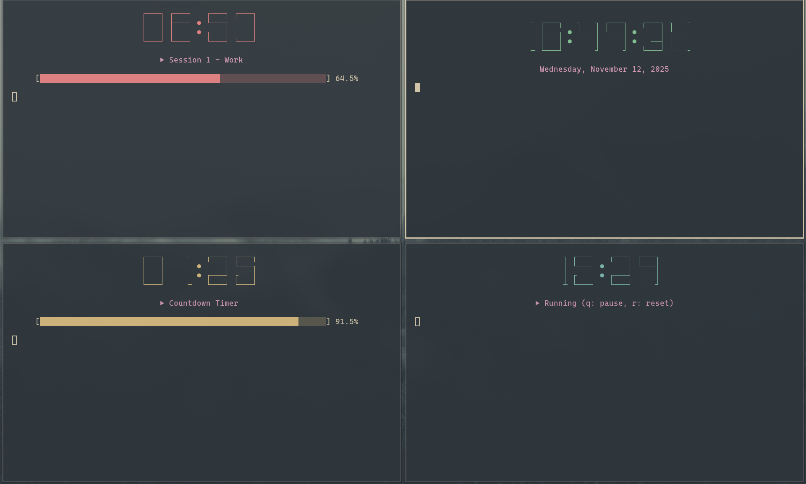

# CLI Digital Clock ⏰

A feature-rich command-line digital clock with Pomodoro timer, stopwatch, and countdown timer functionality. Displays time using large ASCII art digits with customizable styles and colors.

## Features

- **Digital Clock** - Real-time display of current time and date
- **Pomodoro Timer** - Work/break session management
- **Stopwatch** - Count up timer with pause, resume, and reset
- **Countdown Timer** - Flexible countdown with multiple time formats
- **Focus Mode** - Minimal display without labels
- **Progress Bars** - Visual progress indication for timers
- **Pause/Resume** - All timers support pause and resume functionality
- **Customizable Display** - Bold numbers and color options

## Image


## Requirements

- Python 3.6+
- Unix-like system (Linux, macOS)
- Terminal with ANSI color support

## Installation

1. Clone or download the repository:
```bash
git clone https://github.com/erinrrr/cli-clock.git
cd cli-clock
```

2. Make the script executable:
```bash
chmod +x clock.py
```

3. (Optional) Create a symlink for easy access:
```bash
sudo ln -s $(pwd)/clock.py /usr/local/bin/clock
```

## Command Reference

```
usage: clock.py [-h] [-f] [-b] [--white] [--black] [--bell]
                [-p WORK,BREAK] [-s] [-t TIME]

CLI Digital Clock with Timer Features

options:
  -h, --help            show this help message and exit
  -f, --focus           Focus mode (minimal display)
  -b, --bold            Use bold/thick numbers
  --white               Display all text in white
  --black               Display all text in black
  --bell                Enable bell sound on timer/pomodoro completion (off by default)
  -p WORK,BREAK, --pomodoro WORK,BREAK
                        Pomodoro timer (work,break minutes, e.g., 25,5)
  -s, --stopwatch       Stopwatch mode
  -t TIME, --timer TIME
                        Countdown timer (MM:SS, HH:MM:SS, or seconds)
```

## Timer Formats

The countdown timer (`-t`) accepts three formats:

| Format | Example | Description |
|--------|---------|-------------|
| Seconds | `90` | 90 seconds (1 minute 30 seconds) |
| MM:SS | `10:30` | 10 minutes 30 seconds |
| HH:MM:SS | `1:30:00` | 1 hour 30 minutes |

## Keyboard Controls

During stopwatch or timer modes:

| Key | Action |
|-----|--------|
| `q` | Pause/Resume |
| `r` | Reset (stopwatch only) |
| `Ctrl+C` | Exit program |

## Tips

> you can find more usage examples in the [[files/usage & examples.md]] file!

1. **Use focus mode for distraction-free timing:**
   ```bash
   ./clock.py -f -p 25,5
   ```

2. **Combine with system commands:**
   ```bash
   ./clock.py -t 10:00 && notify-send "Timer Complete!"
   ```

3. **Create aliases in your `.bashrc` or `.zshrc`:**
   ```bash
   alias pomodoro='~/path/to/clock.py -f -p 25,5'
   alias timer='~/path/to/clock.py -f -t'
   alias stopwatch='~/path/to/clock.py -s'
   ```

## Troubleshooting

**Script doesn't run:**
- Ensure it's executable: `chmod +x clock.py`
- Check Python version: `python3 --version` (requires 3.6+)

**Colors don't display correctly:**
- Verify your terminal supports ANSI colors
- Try different terminal emulators (iTerm2, GNOME Terminal, etc.)

**Input not responding:**
- Script requires Unix-like system (Linux, macOS)
- Windows users can use WSL (Windows Subsystem for Linux)

## Contributing

Contributions are welcome! Please feel free to submit pull requests or open issues for bugs and feature requests.

## TO-DO
- [x] dynamic update of the status bar (display now redraws cleanly on terminal resize, including downscale)
- [x] input handler on normal mode (press 'q' to quit the plain clock display)
